<p align="center">
  
</p>

<h1 align="center">🏠 BeeHouse</h1>
<p align="center"><strong>Multi-Tenant Boarding House Management System</strong></p>

<p align="center">
  
  
  
  
  
  
  
</p>

BeeHouse helps boarding house owners manage properties, private rooms, dormitory beds, tenants, contracts, utility readings, and billing in one application. It supports multiple landlords in a shared database, with property-scoped delegation for managers and safeguards around occupancy, financial records, and finalized documents.

The application UI is in Vietnamese. This repository documents a React SPA and a single Laravel backend—not a microservices system.

[Preview](#-application-preview) · [Features](#-key-features) · [Architecture](#-system-architecture) · [Local setup](#-getting-started) · [Testing](#-testing) · [Interview guide](docs/PROJECT_FOR_CV.md)

## 🖥️ Application Preview

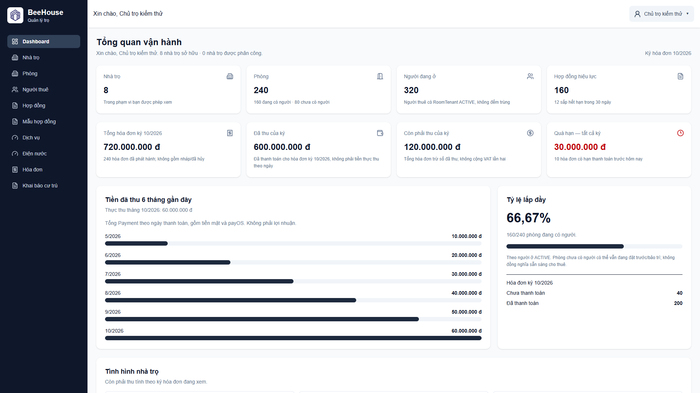

> Real application screenshots, captured locally with synthetic/demo data. Names, identity numbers, balances, and the example bank QR are illustrative—not production records or payment instructions. Dashboard figures do not represent real customers or revenue. Click any screenshot to inspect it at full resolution.

<details>
<summary><strong>Explore the desktop modules</strong> — properties, rooms, tenants, contracts, billing, utilities, and residence forms</summary>

| Property management | Room management |
| --- | --- |
| 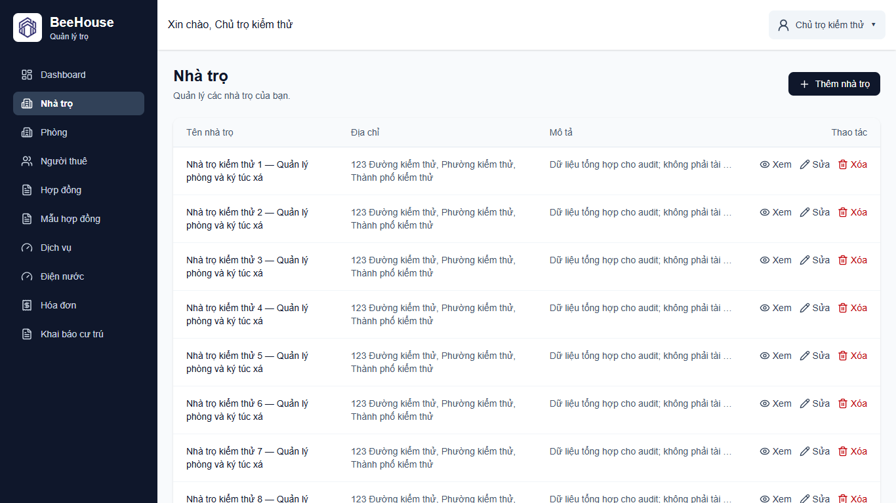 | 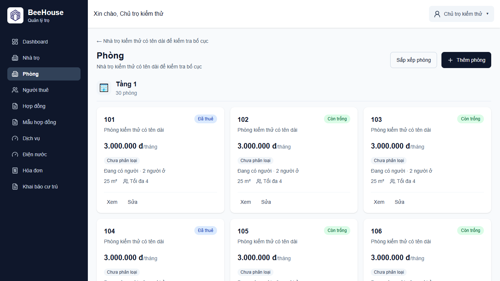 |
| Tenant management | Contract creation |
| 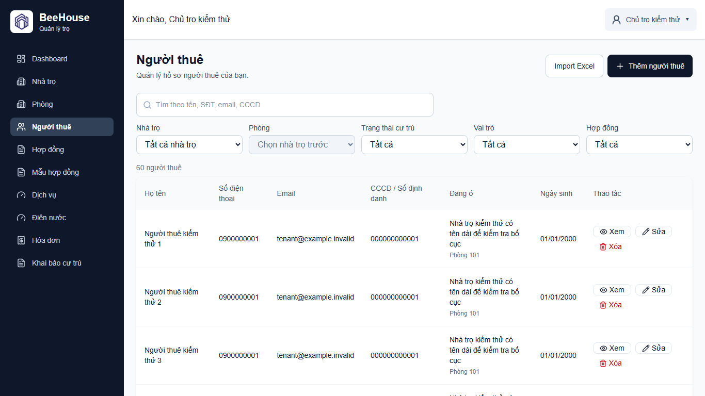 | 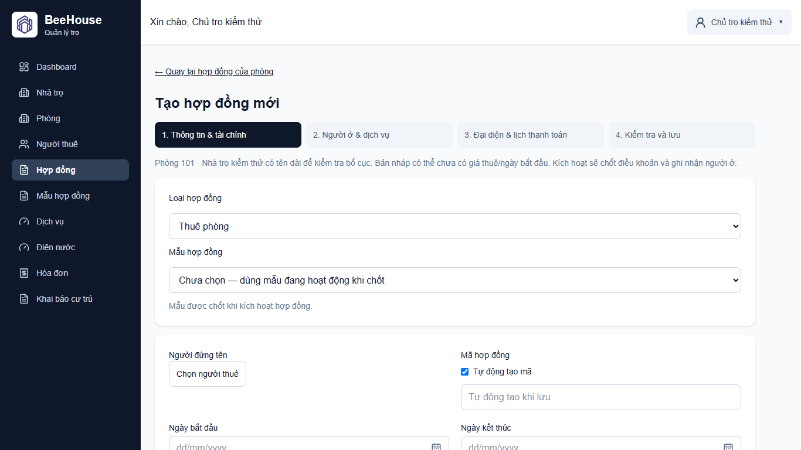 |
| Invoice and bank QR preview | Utility readings |
| 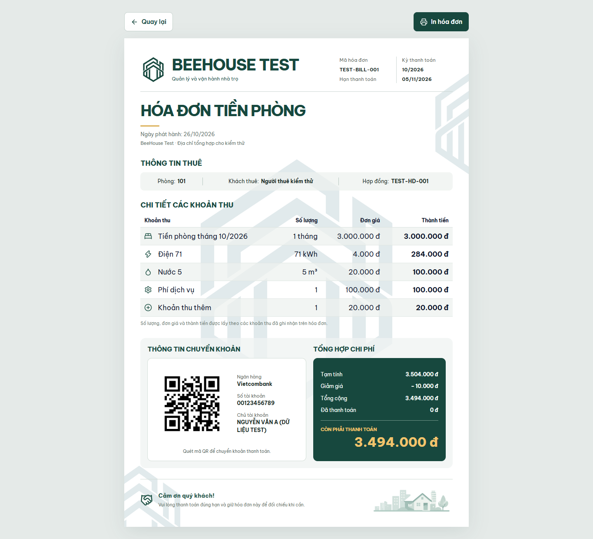 | 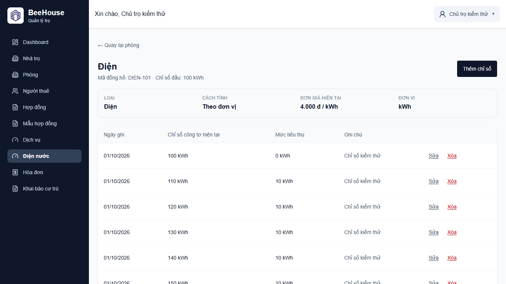 |
| Residence declaration | |
| 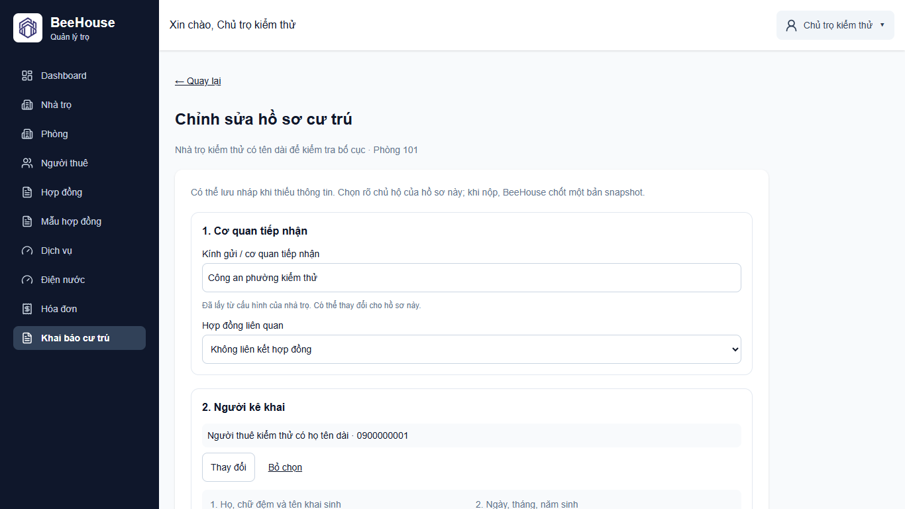 | Draft forms, print views, and payment settings are part of the same application. |

</details>

<details>
<summary><strong>Mobile gallery</strong> — responsive dashboard and tenant selection</summary>

<table>
  <tr>
    <th>Dashboard · 390 × 844</th>
    <th>Tenant picker · 390 × 844</th>
  </tr>
  <tr>
    <td align="center">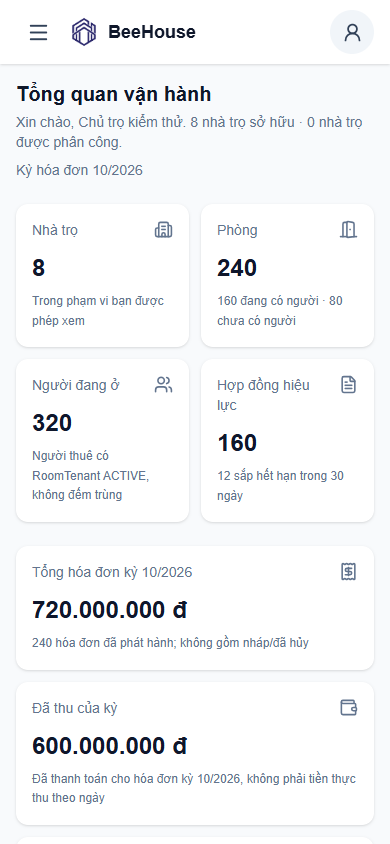</td>
    <td align="center">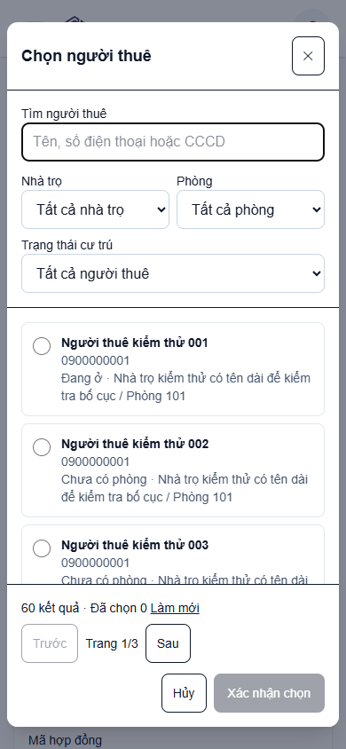</td>
  </tr>
</table>

These are browser viewport captures, not screenshots from physical iOS or Android devices. Print-oriented tables may scroll horizontally on small screens.

</details>

## ✨ Key Features

| Module | Implemented capabilities |
| --- | --- |
| 🏢 **Property management** | Boarding house CRUD, manager assignment, and transactional creation of a property with multiple rooms and temporary floor definitions. |
| 🛏️ **Rooms and dormitories** | Private rooms, floors, room ordering, amenities, dormitory beds, and occupancy/history views. |
| 👥 **Tenants** | Tenant profiles, search/filtering, Excel `.xlsx` import with preview and confirmation, and a reusable server-paginated single/multi-select tenant picker. |
| 📄 **Contracts** | Room/bed rental agreements, a creation wizard, check-in handover drafts and confirmation, activation checks, versioned templates, frozen documents, and an email-OTP signing flow. |
| 🧾 **Invoices and billing** | Contract/occupancy eligibility checks, landlord-scoped document codes, generated and manual invoice items, service pricing, discounts, payment records, and printable bills. |
| ⚡ **Utilities** | Electricity/water meters, dated reading histories, sequence validation, opening readings, and consumption-based or tiered billing. |
| 💳 **Payments** | Landlord-specific bank profiles and QR uploads, invoice payment snapshots, and PayOS payment links with verified webhook reconciliation. |
| 📋 **Residence declaration** | CT01 and stay-consent preparation, drafts, room-member validation, residence profiles, frozen submission snapshots, and browser print views. No government submission API is claimed. |
| 🔐 **Access control** | Sanctum bearer-token authentication, verified-email login, shared-database ownership checks, and assigned-house MANAGER access for supported workflows. |

Google OAuth, signing email delivery, and PayOS are implemented integrations that require their own configuration. Manager permissions vary by module; they do not grant unrestricted access to every landlord operation. See the [access boundary](docs/ARCHITECTURE.md#7-authorization-and-multi-tenant-isolation).

## 🧰 Technology Stack

| Layer | Technologies | Purpose |
| --- | --- | --- |
| Frontend | React 19, Vite 8, React Router 7 | SPA rendering, development/build tooling, and routing |
| UI and forms | Tailwind CSS 4, Lucide React, React Hook Form, Zod | Responsive layouts, icons, form state, and validation |
| Server state | TanStack Query 5, Axios | Query caching, mutations, HTTP transport, and session-bound request cancellation |
| Backend | PHP 8.3+, Laravel 13, Eloquent | JSON API, application services, relational persistence, and Form Request validation |
| Authentication | Laravel Sanctum 4, Socialite 5 | Personal access tokens, email-based account flows, and Google OAuth |
| Database | MySQL; SQLite for tests | Shared production-oriented schema and isolated feature tests |
| Integrations | PayOS PHP SDK 2, PhpSpreadsheet 5, SMTP | Payment links/webhooks, Excel import, and email notifications/OTP |
| Documents and QR | HTML/CSS print layouts, browser Print/Save as PDF, `qrcode.react`, `jsqr` | Document previews, QR rendering, and QR extraction from uploaded images |
| Testing | PHPUnit 12, Node.js test runner, Playwright browser scripts | Backend behavior, frontend logic/forms, and isolated browser regressions |
| Quality | Laravel Pint, Oxlint | PHP formatting and frontend linting |
| Deployment model | Ubuntu VPS, Nginx, PHP-FPM, MySQL | Operator-reported hosting topology; provisioning and server configuration are not versioned here |

Versions are based on the [backend](backend-api/composer.json) and [frontend](front-end/package.json) manifests and their lockfiles. There is no project CI status badge, Docker deployment, Redis requirement, or server-side PDF library claimed here.

## 🏗️ System Architecture

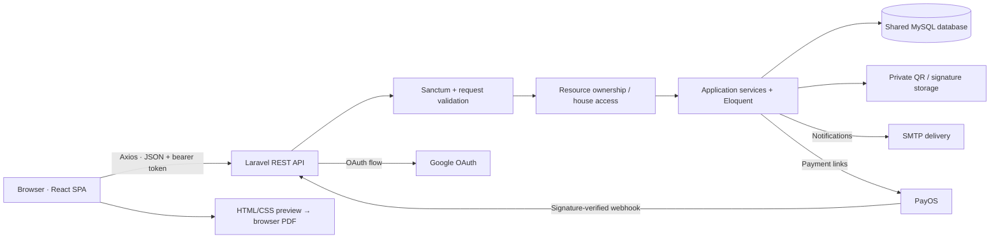

The service boxes are PHP classes inside the same Laravel application. They are not separately deployed services. The [architecture guide](docs/ARCHITECTURE.md) explains the request boundaries, state transitions, and trade-offs with source links.

### Multi-tenant architecture

BeeHouse uses **one shared schema**. A `User` may own a `Landlord` workspace and/or be assigned to other landlords' houses through `boarding_house_managers`. OWNER and MANAGER are roles relative to a house, not global administrative privileges.

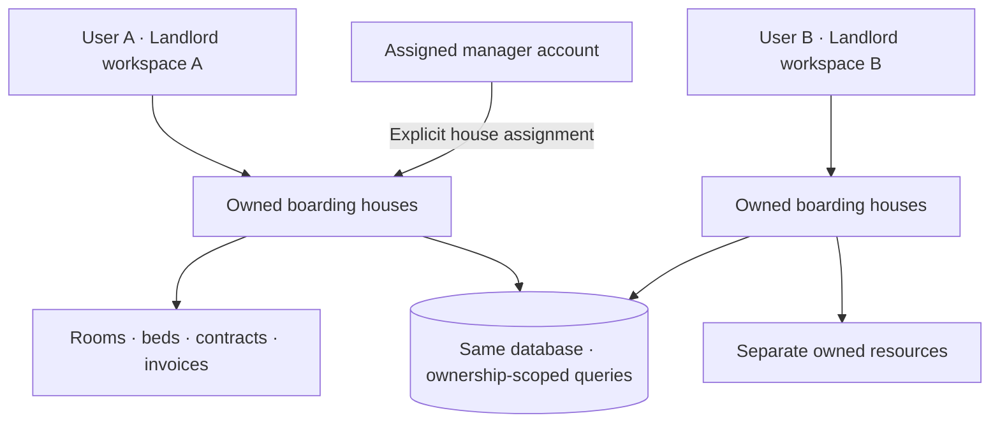

[BoardingHouseAccessService](backend-api/app/Services/BoardingHouseAccessService.php) builds accessible-house queries. Other owner-only endpoints scope directly to the logged-in landlord. Foreign resources are resolved within the allowed scope; frontend filters do not replace authorization. The project currently uses these services/controller queries rather than a dedicated Laravel Policy layer.

### Core database design

<details>
<summary><strong>View the core entity relationships</strong></summary>

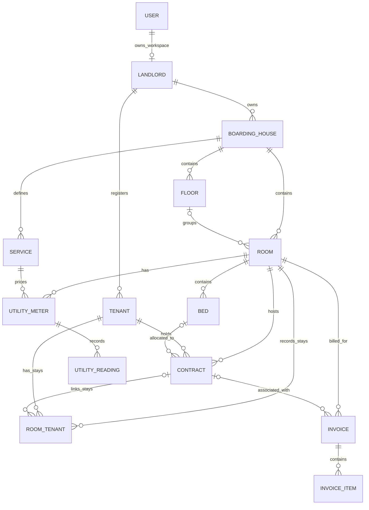

</details>

`RoomTenant` represents a stay, not just a tenant-to-room flag. Some foreign keys are nullable for historical records; **new periodic invoices still require an eligible contract**. Manager assignments, service pivots, payment/signing tables, and detailed keys are covered in the [extended ER diagrams](docs/ARCHITECTURE.md#8-core-entities-and-database-relationships).

## 🔄 Core Business Workflow

1. Create a boarding house, floors, rooms, and beds where applicable.
2. Register tenants manually or preview and confirm an Excel import.
3. Prepare a room/bed contract, confirm its check-in handover, and activate it. Activation validates occupancy and freezes the document and agreed terms.
4. Record meter readings against the correct room/service and billing dates.
5. Create an invoice for an eligible active contract and generate its charges. Missing readings or inconsistent occupancy are rejected rather than guessed.
6. Record payments or reconcile verified PayOS callbacks, then print the bill. Contract and residence documents have their own preview/print flows.

Activation does not automatically charge a deposit or create the first invoice. A finalized document is preserved; changes to important agreed terms require the supported amendment/new-contract flow rather than rewriting signed history.

## 🚀 Getting Started

### Prerequisites

- PHP **8.3+**, Composer, and the PHP extensions required by `composer.lock`, including PDO MySQL, GD, XML/DOM, mbstring, and ZIP. Use `composer check-platform-reqs` to check your CLI installation.
- Node.js **20.19+ in the 20.x line, or 22.12+**, matching Vite's engine requirement, and npm.
- A dedicated local MySQL database and a local SMTP inbox or configured delivery account for email verification. Optional integrations need their own credentials.

### Backend

```bash
git clone https://github.com/VuHoangMinhTu/quan-ly-tro.git
cd quan-ly-tro/backend-api
composer install
cp .env.example .env
php artisan key:generate
```

Create an empty **local** MySQL database. Before migrating, set `DB_CONNECTION=mysql` and configure `DB_HOST`, `DB_PORT`, `DB_DATABASE`, `DB_USERNAME`, and `DB_PASSWORD` in your local `.env`. The example file defaults to SQLite; do not leave that setting unchanged when setting up MySQL.

Set `APP_URL=http://127.0.0.1:8000`, `FRONTEND_URL=http://localhost:5173`, and your local mail settings. Then run:

```bash
php artisan migrate
php artisan db:seed --class=RestoreDefaultContractTemplatesSeeder
php artisan serve --host=127.0.0.1 --port=8000
```

The targeted seeder restores missing default room/dorm templates without creating a sample user or overwriting existing templates. These are **fresh local setup** commands, not instructions to reset an existing environment. Keep private storage and `bootstrap/cache` writable by the backend; bank QR images and signatures are served through controlled endpoints, not public storage links.

### Frontend

In a separate terminal, from the repository root:

```bash
cd front-end
npm ci
cp .env.example .env
npm run dev
```

The frontend example sets `VITE_API_BASE_URL=http://127.0.0.1:8000/api`. Open `http://localhost:5173`, register an account, and verify its email before password login. On PowerShell, use `Copy-Item .env.example .env` instead of `cp` if preferred.

The URL in `FRONTEND_URL` must match the SPA origin allowed by backend CORS. Google OAuth requires the callback in `.env.example`; PayOS requires a configured landlord connection and verified webhook. Signing OTPs require a delivery-capable mailer—do not use a log mailer for signing secrets. See [configuration and deployment boundaries](docs/ARCHITECTURE.md#15-deployment-architecture).

## 🧪 Testing

```bash
# From backend-api — uses the SQLite :memory: configuration in phpunit.xml
php artisan test

# From front-end
node --test src/api/sessionIsolation.test.mjs src/components/forms/InvoiceEligibilityFlow.test.mjs src/components/contracts/ContractLifecycleFlow.test.mjs src/components/forms/ApiFieldErrorsFlow.test.mjs
npm run lint
npm run build
```

**Last verified backend result:** 632/632 tests, 4,382 assertions on SQLite in memory, after the test-fixture triage included in revision `fde531f` (29 October 2026). Related frontend regression: 42/42; isolated session browser regression: 5/5. These are local verification results, not a CI badge or production performance guarantee.

Coverage includes tenant isolation, contract/occupancy rules, invoice eligibility, scoped unique codes, payment reconciliation, imports, and document snapshots. Browser scripts use local synthetic APIs; Laravel feature tests separately exercise the backend. See [browser setup](tests/e2e/README.md) and the [testing strategy](docs/ARCHITECTURE.md#16-testing-strategy). Playwright is an externally supplied test runtime, not a declared frontend dependency.

## 🌐 Deployment

The reported hosting model is **Ubuntu VPS → Nginx → PHP-FPM → Laravel/MySQL**, with a built React SPA. This repository does not include a reproducible Nginx/VPS provisioning bundle or a project GitHub Actions workflow. Server settings, live credentials, and a live-demo availability claim are intentionally omitted. The [deployment diagram](docs/ARCHITECTURE.md#15-deployment-architecture) separates this operating model from verified application code.

## 🛠️ Future Improvements

These are follow-up areas, **not delivered features**:

- Server-side pagination for the main Tenant CRUD list; the shared TenantPicker is already paginated.
- Route-level bundle splitting and improved compact-screen filters/touch targets.
- MySQL-backed concurrency/locking tests and documented deployment configuration.
- A project CI workflow with automated test/build checks.
- Clearer coverage for delegated managers across endpoints that remain owner-only.

## 📚 Project Documentation

- [Architecture and source walkthrough](docs/ARCHITECTURE.md) — boundaries, ER diagrams, lifecycles, integrations, and limitations.
- [CV project summary and interview questions](docs/PROJECT_FOR_CV.md).
- [Full website audit, 28 October 2026](docs/full-website-audit-2026-10-28.md) — historical findings; its original nine failing backend tests were subsequently triaged and fixed in `fde531f`.
- [Session isolation design](docs/session-isolation-fix.md) and [browser verification](docs/session-isolation-e2e.md).
- [Dashboard optimization notes](docs/dashboard-optimization.md) — fixture measurements, not production benchmarks.
- [Browser regression instructions](tests/e2e/README.md).
