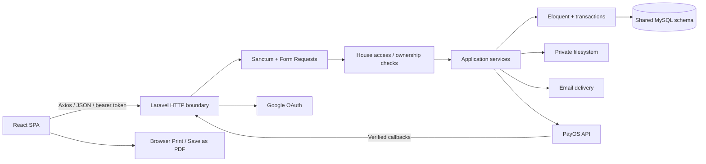
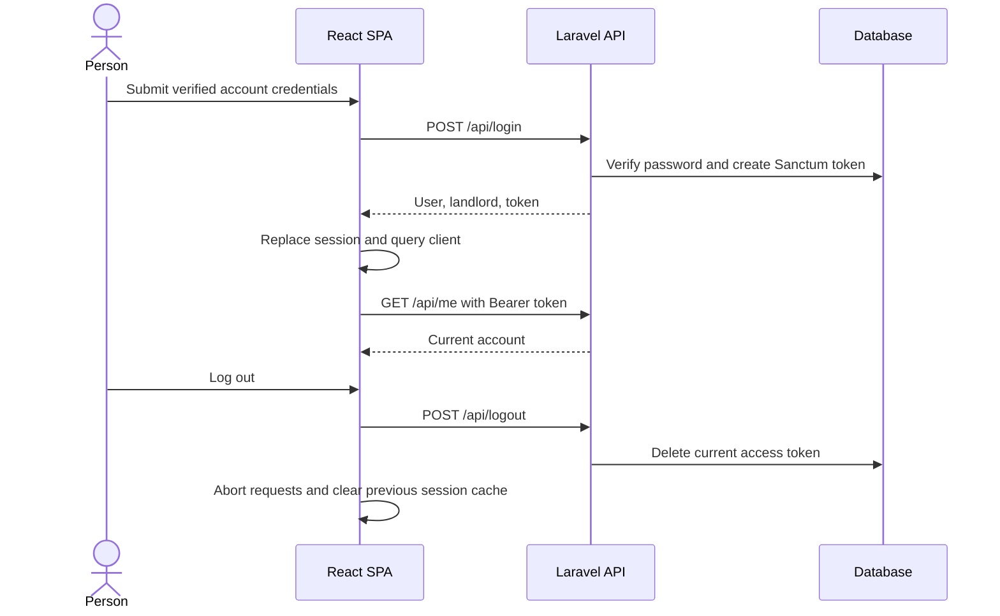
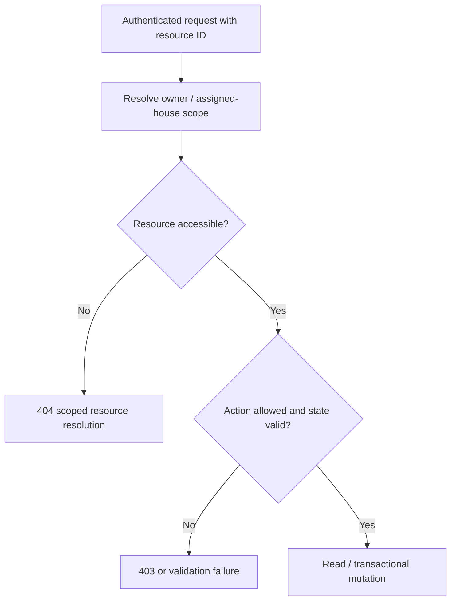
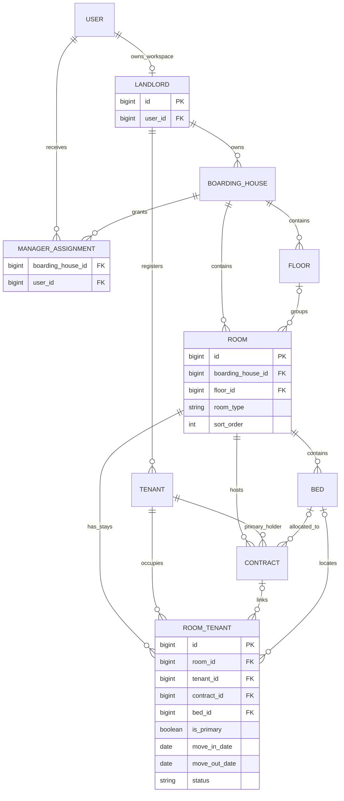
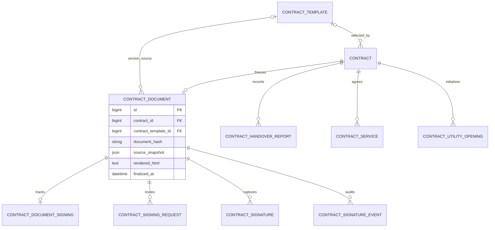
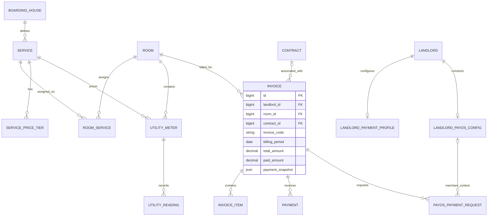
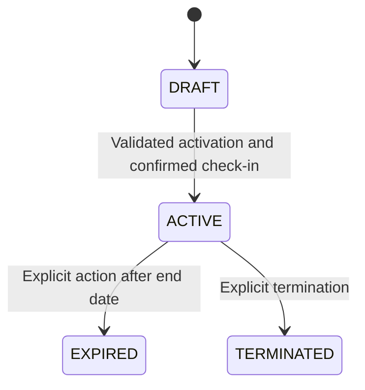
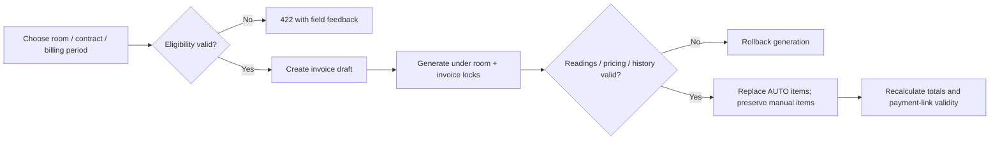
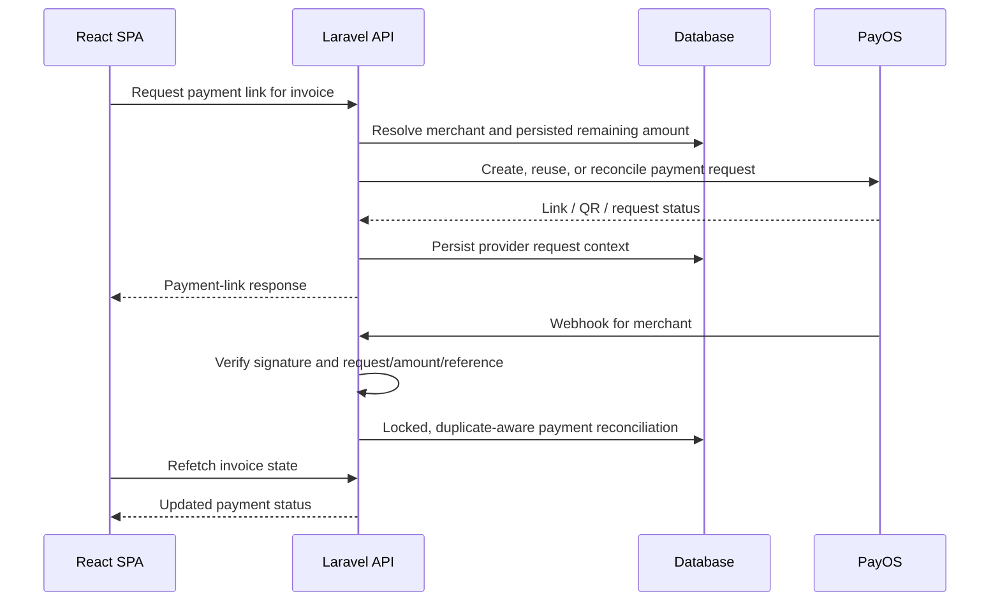
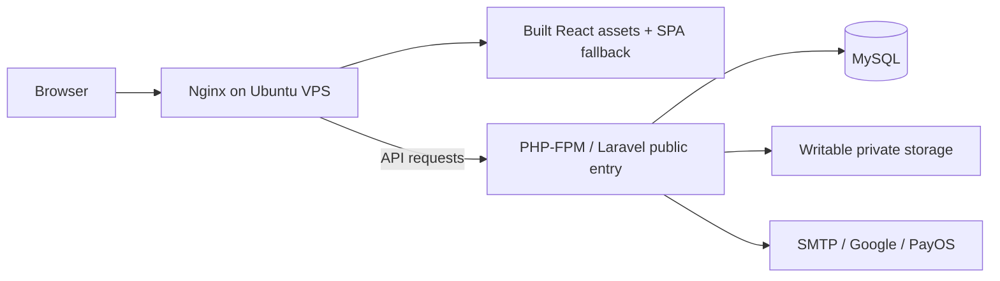

# BeeHouse Architecture

This guide describes the code at revision `fde531f`, reviewed on 29 October 2026. It is an implementation walkthrough for maintenance and technical interviews, not a claim about production capacity, legal certification, or an independently verified VPS configuration.

[Project overview](../README.md) · [CV summary](PROJECT_FOR_CV.md)

## 1. System overview

BeeHouse is a Vietnamese-language management application for boarding houses and dormitories. A React SPA calls a Laravel JSON API; Eloquent persists operational and financial data in a shared relational schema. External boundaries are Google OAuth, email delivery, and PayOS. Documents are HTML/CSS rendered for preview and browser printing.



Entry points: [frontend bootstrap](../front-end/src/main.jsx), [SPA routes](../front-end/src/routes/AppRoutes.jsx), [API routes](../backend-api/routes/api.php), and [Laravel bootstrap](../backend-api/bootstrap/app.php).

## 2. Architectural style

The backend is **one Laravel monolith**. Controllers accept HTTP requests, Form Requests validate inputs, application services coordinate multi-record workflows, and Eloquent models expose persistence and relationships. There is no separate repository abstraction, independently deployed billing service, or message-broker-based microservices architecture in this repository.

This organization keeps workflows such as contract activation and invoice generation inside a single database transaction. The trade-off is that modules share a database and application process; class boundaries do not provide deployment or failure isolation. SMTP and PayOS remain external systems, so a database transaction cannot make a remote call atomic with a local commit.

This is a description of the code structure, not a claim that a particular architectural methodology was formally adopted.

## 3. Frontend folder structure

```text
front-end/src/
├── api/             Axios clients, query keys, session/query infrastructure
├── components/      Forms and feature components: contracts, rooms, tenants, etc.
├── layouts/         Main shell, navigation, drawer, account menu
├── notifications/   Shared Toast store, provider, and form feedback
├── pages/           Route-level screens and document print pages
├── routes/          React Router configuration and protected-route boundary
├── utils/           Dates, validation, pricing helpers, QR image processing
└── assets/          Existing branding and illustrations
```

Pages coordinate route parameters, queries, mutations, and navigation; reusable feature components implement interactions such as the contract wizard and tenant picker. React Hook Form and Zod handle client validation. The backend remains authoritative for authorization, eligibility, and financial rules.

[queryClient.js](../front-end/src/api/queryClient.js) defines shared query/mutation behavior. General automatic retries are disabled, while individual queries can override this. [TenantPickerDialog](../front-end/src/components/tenants/TenantPickerDialog.jsx) uses filter/page-aware query keys, a 300ms debounce, and Axios cancellation signals. The main Tenant CRUD page is a different consumer and remains unpaginated.

[ToastProvider](../front-end/src/notifications/ToastProvider.jsx) renders the shared result notifications. [notificationTransport.js](../front-end/src/api/notificationTransport.js) centralizes API mutation feedback and de-duplicates reported errors; [formFeedback.js](../front-end/src/notifications/formFeedback.js) handles invalid form submissions. A Toast reports a result; it is not a substitute for a destructive-action confirmation.

## 4. Backend folder structure

```text
backend-api/
├── app/Http/Controllers/Api/  HTTP actions and resource resolution
├── app/Http/Requests/        Input validation for feature endpoints
├── app/Http/Middleware/      API locale, signing privacy, and related middleware
├── app/Models/               Eloquent entities, relationships, casts, hooks
├── app/Services/             Billing, access, contracts, signing, imports, PayOS
├── app/Notifications/        Account and contract-signing mail
├── app/Custom/               JSON response helper
├── app/Exceptions/           Domain-specific failure types
├── config/                   Auth, mail, storage, signing, integrations, CORS
├── database/migrations/      Schema, ownership keys, constraints, indexes
├── database/seeders/         Source-backed default contract templates
├── resources/views/          Contract HTML sources and email views
├── routes/api.php            API routes, middleware groups, webhooks
└── tests/                    PHPUnit feature/unit tests and fixtures
```

For example, [ContractService](../backend-api/app/Services/ContractService.php) orchestrates activation, [BillingService](../backend-api/app/Services/BillingService.php) generates charges, and [BoardingHouseAccessService](../backend-api/app/Services/BoardingHouseAccessService.php) resolves house-level access. These classes run inside the same Laravel application.

There are two distinct `ContractService` names: the application service in `app/Services/` coordinates contract workflows; the [Eloquent model in app/Models](../backend-api/app/Models/ContractService.php) represents a stored contract service term. PHP namespaces distinguish them.

## 5. REST API design

Routes use the `/api` prefix. Examples below are implemented route families, not a complete OpenAPI specification.

| Area | Representative endpoints | Boundary |
| --- | --- | --- |
| Account | `POST /api/register`, `POST /api/login`, `GET /api/me`, `POST /api/logout` | Registration/login public; account reads/logout authenticated |
| Properties | `/api/boarding-houses`, `/api/boarding-houses/{id}/rooms`, `/api/boarding-houses/with-rooms` | Resource ownership and supported manager access |
| Tenant selection | `GET /api/tenant-lookup`, `GET /api/tenant-lookup/options` | Minimal paginated DTO with ownership/context checks |
| Contracts | `/api/rooms/{roomId}/contracts`, `/api/contracts/{id}/status`, `/api/contracts/{id}/handover-check-in` | Accessible room plus action/lifecycle checks |
| Invoice eligibility | `GET /api/rooms/{roomId}/invoice-contracts` | Current eligible contracts for the chosen billing period |
| Invoices | `/api/rooms/{roomId}/invoices`, `/api/invoices/{id}/generate` | Scoped reads and protected financial mutations |
| Meter readings | `/api/utility-meters/{id}/readings` | Owner-scoped meter and reading validation |
| Residence | `/api/residence-declarations`, `/api/residence/rooms/{id}/context` | Accessible property and valid room members |
| PayOS | `/api/webhooks/payos/{webhookUuid}` | Public transport endpoint; merchant/signature verification required |
| Public signing | `/api/sign/{token}` and its OTP/sign actions | Dedicated signing token and verification flow; not a landlord API token |

[ApiResponse](../backend-api/app/Custom/ApiResponse.php) wraps successful responses as `{ success, message, data }` and errors as `{ success: false, message, errors }`. A successful mutation can return `data: null`; clients must not assume every write returns a model ID. Laravel's exception handling normalizes API failures and validation responses.

Pagination is endpoint-specific. The tenant lookup returns `tenants`, `total`, `current_page`, `last_page`, and `per_page` inside `data`. Invoice lists return `data.items` and `data.pagination`. Several older list endpoints still return arrays. Treat these as distinct contracts rather than assuming one global list shape.

## 6. Authentication flow

[AuthController](../backend-api/app/Http/Controllers/Api/AuthController.php) creates the User and Landlord together, sends email verification, and rejects password login for an unverified email. Successful login issues a **Sanctum personal access token**. This is an opaque bearer token, not JWT authentication.



The SPA stores the token in local storage. [sessionTransport.js](../front-end/src/api/sessionTransport.js) attaches it to requests and associates each request with the current session. [session.js](../front-end/src/api/session.js) replaces the QueryClient, aborts old requests, and clears notifications on a session change; late responses from an old session are discarded. A relevant 401 ends the authenticated client session.

[cors.php](../backend-api/config/cors.php) explicitly supports bearer-token requests without credential cookies. The presence of a Sanctum stateful-domain configuration does not mean this SPA uses Sanctum's cookie-based login flow. Local-storage token persistence also means XSS prevention remains important; this guide does not claim that browser storage is immune to token theft.

[GoogleAuthController](../backend-api/app/Http/Controllers/Api/GoogleAuthController.php) uses Socialite's Google redirect/callback and a separate frontend exchange endpoint. It is a configured integration, not a dependency required for ordinary password login. Password recovery uses Laravel's password broker.

## 7. Authorization and multi-tenant isolation

A landlord is an ownership/workspace record, not a separate database. The shared schema contains `landlord_id` on directly owned records and ownership paths through boarding houses and rooms for related data.

[BoardingHouseAccessService](../backend-api/app/Services/BoardingHouseAccessService.php) returns houses owned by the user's Landlord record **or** explicitly assigned through `boarding_house_managers`. `house()` and `room()` resolve IDs within that scope. Locking writes recheck house access under the corresponding lock. `isOwner()` distinguishes an owner from an assigned manager for a specific house.



The repository has no dedicated `app/Policies` implementation. Authorization is distributed across the access service, scoped controller queries, owner checks, and workflow-specific validation. A request's `landlord_id` or filter IDs never replace the authenticated ownership calculation.

| Resource/workflow | Current access pattern |
| --- | --- |
| Accessible property/room views, contract workflows, dashboard, residence preparation | House-based OWNER/MANAGER scope; additional action checks still apply |
| Tenant lookup | Owners can find their workspace tenants; managers are constrained to assigned-house membership context. Identity-number search is owner-limited. |
| Tenant CRUD/import, utility reading CRUD, landlord payment settings | Owner-oriented endpoints; manager assignment does not make every owner-only operation available |
| Invoice reads | Accessible-house queries for supported reads; writes have their own owner/financial/eligibility checks |
| Signing | Finalized document, intended signer, hashed request/verification tokens, OTP, and document state |
| PayOS callbacks | Resolve merchant/request and verify the provider payload, independently of a browser login |

For instance, [TenantLookupController](../backend-api/app/Http/Controllers/Api/TenantLookupController.php) validates context/filter access, excludes unrelated tenants, and returns only selection fields. Its `ACTIVE_ROOM` mode is used for residence forms. A historical contract alone does not establish current occupancy.

Cross-owner reads/writes and revoked tokens are covered by [SessionIsolationApiTest](../backend-api/tests/Feature/SessionIsolationApiTest.php); manager and lookup boundaries have [manager tests](../backend-api/tests/Feature/BoardingHouseManagerApiTest.php) and [lookup tests](../backend-api/tests/Feature/TenantLookupApiTest.php). This does not establish a complete uniform RBAC matrix for every endpoint.

## 8. Core entities and database relationships

Models define the application relationships; migrations define constraints. The diagrams are grouped to keep ownership, workflow records, and money flows readable. Optional edges describe the schema, including legacy records—not permission to bypass current API validation.

### Property and occupancy



`MANAGER_ASSIGNMENT` denotes the actual `boarding_house_managers` pivot. `landlords.user_id` is unique; room floor assignments and stay-to-contract/bed references are nullable. Contract and invoice ownership keys are populated from the room's boarding house, not accepted as an arbitrary client choice.

See [RoomTenant](../backend-api/app/Models/RoomTenant.php), [Room](../backend-api/app/Models/Room.php), [Contract](../backend-api/app/Models/Contract.php), and [migrations](../backend-api/database/migrations). Floors, beds, tenants, and contracts are separate entities; a dormitory is represented by `room_type`, not a second property database.

### Contract documents and signatures



A draft contract may not yet have a selected template or document. The selected template version and source data become part of the finalized document. Signing state/request/signature/event records belong to that document rather than changing its frozen HTML.

### Billing and payments



`ROOM_SERVICE` denotes the actual `room_services` pivot. Utility readings belong to a **meter**; they are not directly attached to a service or invoice. Invoice contract/config references allow legacy cases in the schema, but new periodic invoice creation requires an eligible contract. A missing historical payment snapshot is distinct from an unconfigured current bank profile.

[DocumentCodeService](../backend-api/app/Services/DocumentCodeService.php) resolves landlord ownership, serializes code allocation under locks, and keeps per-landlord/type/year sequences. The [ownership migration](../backend-api/database/migrations/2026_10_24_091712_scope_document_codes_to_landlords.php) adds database uniqueness for `(landlord_id, contract_code)` and `(landlord_id, invoice_code)`; invoice and contract code sequences are distinct.

Residence data adds a `BoardingHouseResidenceProfile`, `ResidenceDeclaration`, and `ResidenceDeclarationMember`. The declaration references its house/room, an optional related contract, and selected tenant records; a frozen snapshot preserves document data after submission. A `TenantImport` is a temporary preview/confirmation session, not an occupancy or contract record.

## 9. Contract lifecycle



[ContractService](../backend-api/app/Services/ContractService.php) locks the accessible house and room before activation decisions. It checks required agreed terms, representative access, room/bed overlap, capacity and occupancy consistency, and required utility openings. [ContractHandoverService](../backend-api/app/Services/ContractHandoverService.php) separates save-draft and confirm operations; deleting handover items is a draft-only action.

Activation creates/links occupancy rows, records `signing_snapshot`, and invokes [ContractDocumentService](../backend-api/app/Services/ContractDocumentService.php) to capture the selected template, rendered HTML, source snapshot, and SHA-256 document hash. The [ContractDocument model](../backend-api/app/Models/ContractDocument.php) rejects updates and deletion through its Eloquent lifecycle.

Finalized core terms cannot be edited as if they were a draft. Dedicated service-term adjustment flows are handled by [ContractServiceTerms](../backend-api/app/Services/ContractServiceTerms.php). Important changes outside those supported adjustments require a new contract. There is no claim that activation collects a deposit, generates an initial invoice, or that expiry is automatically scheduled.

Email-OTP signing is a separate document workflow in [ContractSigningService](../backend-api/app/Services/ContractSigningService.php). Signing requests and OTP verification use expiry/attempt limits, hashes, document checks, private signature files, and audit events. [SigningMailService](../backend-api/app/Services/SigningMailService.php) rejects unsafe log-based mailers. Signing notifications are intentionally synchronous to avoid serializing secret OTP/link bodies into a queue. This is an application signing workflow, not a certified PKI-based digital-signature platform.

## 10. Tenant occupancy lifecycle

Contracts identify the primary legal holder; `RoomTenant` records who is physically staying in a room, when, and optionally under which contract/bed. One tenant can therefore have multiple historical stays without being considered currently resident in every past room.

Current occupancy uses active stay records. Contract-linked occupancy is protected from deletion or arbitrary rewriting; move-out records preserve history. [RoomTenantController](../backend-api/app/Http/Controllers/Api/RoomTenantController.php) coordinates owner-operated stay changes and bed reservations. Contract workflows also coordinate linked stays and room state.

Ending a contract and recording a departure are distinct decisions: the transition path updates active stays when a move-out date is supplied, rather than inventing one from a status label. Likewise, an old signing snapshot is not a live tenant directory.

In CT01 preparation, [ResidenceDeclarationService](../backend-api/app/Services/ResidenceDeclarationService.php) requires the declarant and selected members to be active occupants of the chosen room. Legal household-head/owner data comes from explicit residence configuration and form input; an application's OWNER/MANAGER role does not establish legal ownership of the accommodation.

## 11. Invoice generation and billing rules

[InvoiceContractEligibility](../backend-api/app/Services/InvoiceContractEligibility.php) separates invoice eligibility from arithmetic. A new periodic invoice must use the correct landlord/room contract, with ACTIVE status, applicable dates, agreed rent, and valid current primary occupancy. Dormitory checks also verify the bed relationship/state. An ambiguous or unlinked stay is not silently assigned to a contract.



[BillingService](../backend-api/app/Services/BillingService.php) implements `FIXED`, `PER_PERSON`, `PER_UNIT`, and `TIERED` pricing. Current room service assignments gate generation; effective contract service terms supply agreed prices/tier snapshots where present. A newly assigned service without a matching stored term can use its configured live pricing. Missing or overlapping required terms are validation failures, not guessed prices.

Two occupancy concepts are deliberately different:

- **New-invoice eligibility** requires a valid current contract/primary resident.
- **PER_PERSON quantity** counts distinct tenants from linked stays overlapping the billing month, including valid departed stays for that period. Multiple qualifying stay rows for the same tenant count once. It is not simply the number of people visible in today's room card or in the original contract snapshot.

Generation replaces `source=AUTO` items transactionally; manual invoice items are retained. Contract rent supplies the rent item instead of treating a missing room default as zero. Utility usage must have a usable opening and closing reading. The [Invoice model](../backend-api/app/Models/Invoice.php) recalculates subtotal, discount, and total and restricts financial editing after payment activity.

Database money columns use decimal types; billing arithmetic uses Brick Math decimal operations. Some payment/status comparison paths still use floats, so this is not a claim of uniformly decimal arithmetic across every financial method. SQLite tests do not prove MySQL locking or simultaneous-request behavior.

## 12. Utility meter reading flow

A room can have meters linked to its configured electricity/water services. Readings are dated values attached to `UtilityMeter`, with an opening value and optional contract opening captured at handover.

[UtilityReadingController](../backend-api/app/Http/Controllers/Api/UtilityReadingController.php) checks duplicate dates and compares a new/edited reading with the surrounding readings. [BillingService](../backend-api/app/Services/BillingService.php) selects the relevant period boundaries, uses the applicable opening, rejects a missing closing reading or negative consumption, and applies the selected billing method.

The separation matters: recording a reading does not itself create a payment or mutate a finalized contract. The room/service/meter identity and the reading dates all affect which quantity can legitimately be billed.

## 13. Payment integration

### Bank profiles and uploaded QR images

[LandlordPaymentSettingsController](../backend-api/app/Http/Controllers/Api/LandlordPaymentSettingsController.php) manages an owner's bank fields and validated QR image uploads. [InvoicePaymentInfoService](../backend-api/app/Services/InvoicePaymentInfoService.php) uses the current profile for unissued drafts and captures payment details when an invoice is issued. Previously issued invoices with missing snapshots are surfaced as missing historical information, not silently rewritten from the current profile.

Images are served through authorized endpoints; the browser obtains blobs rather than relying on a public QR file URL. [PrivatePaymentQr](../front-end/src/components/payments/PrivatePaymentQr.jsx) and [paymentQrImage.js](../front-end/src/utils/paymentQrImage.js) support extracting a QR region for the bill while retaining scan readability. An uploaded bank QR is not the same object as a PayOS payment request.

### Manual payments and PayOS

[InvoicePaymentService](../backend-api/app/Services/InvoicePaymentService.php) recomputes paid amount/status from payment records. [PayOSService](../backend-api/app/Services/PayOSService.php) handles landlord merchant credentials, payment-link creation/reuse, ambiguous remote-request reconciliation, amount changes, and provider webhooks. API/checksum secrets in [LandlordPayOSConfig](../backend-api/app/Models/LandlordPayOSConfig.php) use encrypted casts and are hidden from serialization.



The browser's success return URL is not proof of payment. The service verifies provider callbacks, matches merchant/order/payment-link and amount, checks duplicate references under locks, and guards overpayment before recording funds. Uncertain remote outcomes require reconciliation; the system does not pretend that a network timeout proves a remote request was never created. This is an idempotency/reconciliation design, not a blanket exactly-once delivery guarantee.

SMTP, OAuth, and PayOS are implemented integration boundaries. Live delivery, merchant activation, webhook routing, and actual bank transactions require operational configuration and are not proven by mocked tests.

## 14. Document rendering and PDF generation

There is no installed Dompdf, mPDF, or browser-PDF backend package in the application manifests. Contract, invoice, CT01, and stay-consent views use HTML/CSS and browser printing. Playwright's `page.pdf()` appears in regression scripts, not as a production PDF service.

| Document | Source and persistence boundary |
| --- | --- |
| Room/dorm contracts | Source HTML in `backend-api/resources/views/`; template records/version selection; renderer and frozen `ContractDocument` |
| Contract previews/demo | `ContractTemplateDemo` and shared frontend `ContractDocumentSheet`; demo does not create contracts/payments |
| Bill | `InvoicePrintPage` / `InvoicePrintLayout`; stored invoice items, totals, owner profile/snapshot and authorized QR |
| CT01 and stay consent | `ResidenceDeclarationService` data/snapshots with `Ct01Document` / `StayConsentDocument` print layouts |

[ContractTemplateRenderer](../backend-api/app/Services/ContractTemplateRenderer.php) and [ContractTemplateHtml](../backend-api/app/Services/ContractTemplateHtml.php) prepare supported template HTML and substitutions. Finalized document reads verify the stored hash. Signature presentation does not require rewriting the frozen document HTML.

[RestoreDefaultContractTemplatesSeeder](../backend-api/database/seeders/RestoreDefaultContractTemplatesSeeder.php) is a targeted, idempotent recovery/setup path: it restores missing global templates from source, preserves existing versions/status/content, and refuses dangling template references. It cannot restore deleted contracts or residence histories. CT01/stay-consent frontend layouts are not recreated by inserting fake residence records.

The household head, legal accommodation owner, declarant, and application operator are different roles. Residence statuses are managed locally; BeeHouse prepares documents and tracks state, but does not submit to a government service or certify the legal validity of signatures.

## 15. Deployment architecture

The operator-reported deployment topology is Ubuntu VPS, Nginx, PHP-FPM, and MySQL. No versioned Nginx site configuration, Docker stack, infrastructure-as-code, or project GitHub Actions workflow was found during this review. The diagram is an operating model, not evidence of inspected server settings.



Configuration responsibilities:

- Use the SPA build generated by `front-end/package.json` scripts and set `VITE_API_BASE_URL` before building; Vite environment values are public client configuration, not a place for secrets.
- Match `APP_URL`, `FRONTEND_URL`, OAuth redirect, CORS origin, and PayOS return/callback addresses to the intended environment. Configure only trusted proxy addresses where needed.
- Keep `APP_KEY`, database credentials, signing/SMTP secrets, and PayOS credentials outside Git; set production debug behavior appropriately. Preserve the application key needed for encrypted configuration.
- Make Laravel storage/cache paths writable and keep private signatures/QR storage protected. A public `storage:link` is not a requirement for these protected images.
- Configure delivery mail for account verification/password resets and a safe signing mailer. Current signing mail is synchronous; the existence of database queue configuration does not mean signing OTPs are queued.
- Coordinate database migrations, backups, and asset publication as an operational procedure. This guide does not run deployment steps or prescribe destructive database resets.

The [backend example environment](../backend-api/.env.example) defaults to SQLite and includes optional framework settings. Redis/S3 placeholders in that scaffold are not evidence those services are required or deployed. The root setup instructions deliberately use a dedicated local database and a targeted template seeder rather than creating the sample `DatabaseSeeder` user.

## 16. Testing strategy

| Layer | Actual tooling | What it verifies |
| --- | --- | --- |
| Backend | PHPUnit 12, Laravel feature/unit tests | Validation, scopes, lifecycle/eligibility rules, snapshots, imports, payments, document codes |
| Frontend | Node's built-in `node:test`, assertions, React/form harnesses | Session/cache behavior, payloads, helpers, form validation, component behavior |
| Browser | Local Playwright scripts and isolated HTTP fixtures | Navigation, focus/mobile layout, duplicate submit prevention, late responses, QR/print regressions |
| Quality | Laravel Pint, Oxlint, Vite build | Formatting, frontend lint checks, and bundle compilation |

[phpunit.xml](../backend-api/phpunit.xml) configures SQLite `:memory:`, array mail/cache/session, and isolated test settings. The verified full backend run for `fde531f` passed **632/632 tests, 4,382 assertions**. The related frontend run passed **42/42**, and session-isolation browser tests passed **5/5**. These figures describe the local 29 October 2026 verification, not automatically running CI.

Read [tests/e2e/README.md](../tests/e2e/README.md) before browser runs. Playwright/Chromium must be supplied separately; they are not declared frontend dependencies. The current scripts support explicit runtime paths. They block unexpected external origins and use synthetic API responses. Do not point a fixture runner at production or interpret its timing as Laravel/MySQL latency. Vite-based runners share a cache, so run them sequentially to avoid cache races.

The nine backend failures recorded in the earlier [audit](full-website-audit-2026-10-28.md) were subsequently fixed by updating four test files: KTX room type, invoice eligibility fixtures, a no-contract expectation, and invoice pagination assertions. No business validation was relaxed. SQLite still cannot prove MySQL row-lock contention, throughput, or live integration behavior.

## 17. Known technical limitations

| Status | Area | Current boundary / next verification |
| --- | --- | --- |
| Implemented | Core property, tenant, contract, utility, invoice, residence workflows | Available code paths and regression coverage; not a claim that every production edge case is proven |
| Implemented, configuration-dependent | Google, email signing, PayOS | Real credentials, delivery and callback configuration required; no live availability/payment guarantee |
| Partial coverage | Manager access | House-scoped workflows coexist with owner-only endpoints; no universal policy-based permission matrix |
| Partial scalability | List endpoints | TenantPicker/invoice lists paginate; Tenant CRUD and some room/context lists still fetch whole collections |
| Follow-up | Frontend delivery | Routes currently import pages statically; route-level splitting remains an improvement area |
| Follow-up | Compact UI/accessibility | Very short viewports, touch targets, and some form-label associations need refinement; print layouts may scroll horizontally |
| Not established | Production performance | Local fixture benchmarks and SQLite runs are not MySQL/FPM/network load tests; no supported concurrent-user capacity is stated |
| Not provided | Reproducible deployment / CI | No repository-owned VPS provisioning bundle or GitHub Actions workflow |
| Not provided | Certified signatures / government integration | OTP signing and printable residence preparation are application features, not PKI certification or government submission |

These limitations are documented separately from the implemented features. They are not changes made by this documentation task, and the roadmap does not imply an approved implementation schedule.
